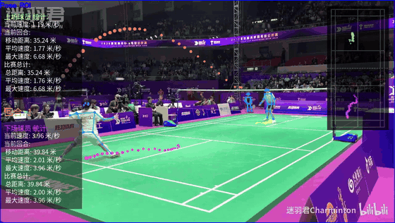
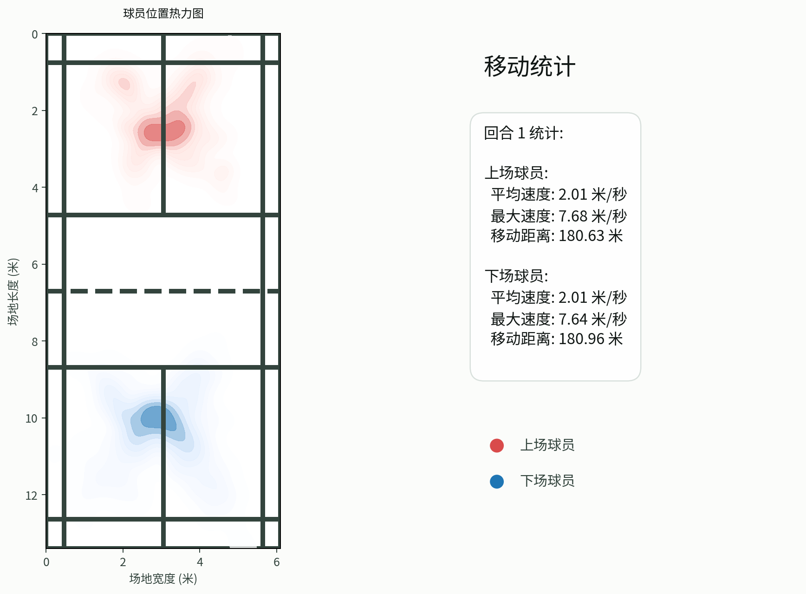
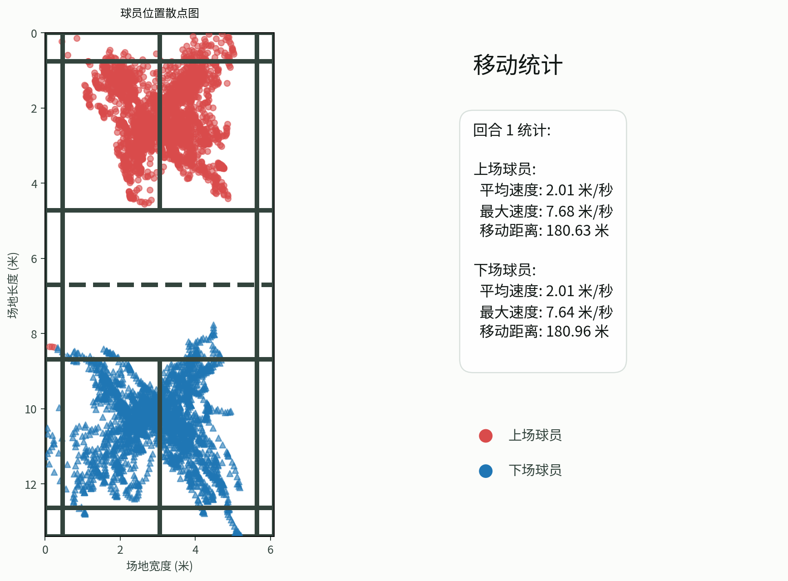
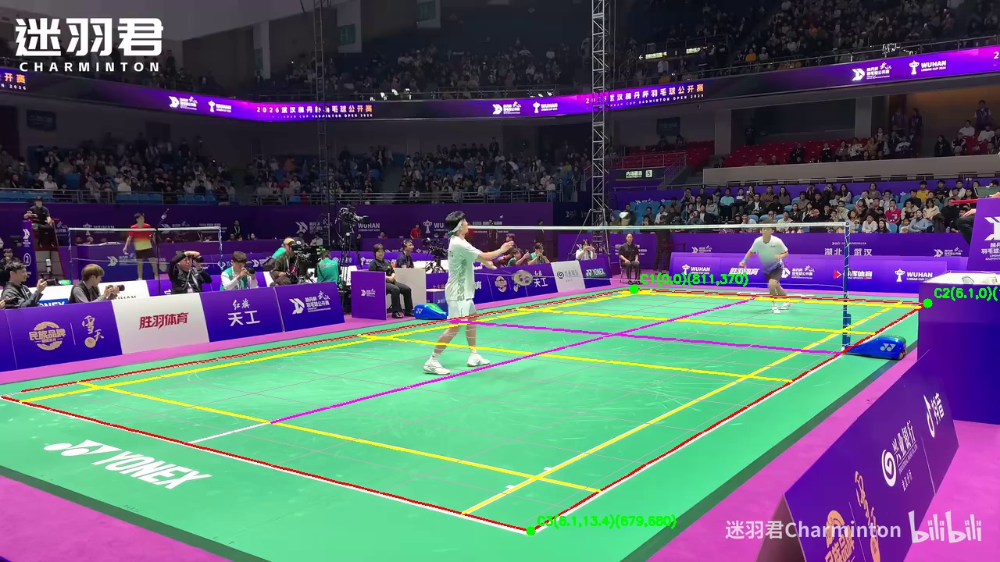

<div align="center">

# 🏸 AI-YuJian-AI · 羽见 AI（低视角自动标定版）

### 把比赛录像变成可复盘的球场数据 —— 即使相机只架在场边地上

[](https://www.python.org/)
[](web/frontend/)
[](web/api/)
[](LICENSE)

**一个本地优先的羽毛球比赛视频分析工具：检测球员姿态、追踪羽毛球、映射球场坐标，并生成可视化复盘结果。**
本仓库 Fork 自 [lzylovec/AI-YuJian-AI](https://github.com/lzylovec/lzylovec-AI-YuJian-AI)，在其基础上新增了**低视角全自动球场标定**（无需高机位、无需手动点角点）。

[快速开始](#-快速开始) · [自动标定](#-低视角自动球场标定) · [拍摄要求](#-拍摄要求与使用建议) · [Web Demo](#-web-demo) · [效果展示](#-效果展示)

🌐 简体中文 | [English](README_EN.md)

</div>

---

## ✨ 项目简介

**AI-YuJian-AI**（羽见 AI）面向羽毛球训练、比赛复盘和计算机视觉研究场景。输入一段比赛视频，完成一次球场标定后，系统会将画面中的检测结果转换为视频叠加层、球场轨迹、运动统计和结构化数据。

它既可以直接通过 Python CLI 运行，也提供一个本地 Web Demo，让上传、截取、标定、排队分析和结果下载都在浏览器中完成。

> **羽见**：看见每一羽，也看见每一次移动。

## 🎬 效果展示

<div align="center">



*完整演示视频：[assets/lowangle_demo.mp4](assets/lowangle_demo.mp4) — 网后低视角实拍（林丹杯比赛片段），球轨迹、骨架、统计面板全程稳定输出*

</div>

| 球员位置热力图 | 球员位置散点图 |
| :---: | :---: |
|  |  |

| 低视角自动标定结果（绿线=球场线投影，蓝线=网底线） |
| :---: |
|  |

传统方案要求在球场正上方高处架机拍"上帝视角"，而实际球馆往往没有二楼机位。本版本针对**网后低视角**（约 1~2 人高）做了专门的自动标定：只需一张视频截图，无需手动点击角点。

## 🚀 快速开始

### 1. 环境要求

- Python 3.8+
- FFmpeg，并加入系统 `PATH`
- 推荐 NVIDIA GPU；CPU 可以运行，但视频分析会明显变慢
- 默认依赖安装 CPU 版 PyTorch 和 ONNX Runtime

### 2. 安装分析依赖

```bash
git clone <你的仓库地址>
cd AI-YuJian-AI

python -m venv .venv

# Windows PowerShell
.\.venv\Scripts\activate

# Linux / macOS
source .venv/bin/activate

python -m pip install --upgrade pip
pip install -r requirements.txt
```

### 3. 准备模型

羽毛球检测权重不会随仓库提交，请从 [上游 Releases](https://github.com/lzylovec/lzylovec-AI-YuJian-AI/releases) 下载并放置到：

```text
weights/yolo11s-ball.pt
```

使用 `rtmpose` 或 `rtmo` 时，`rtmlib` 会按需使用对应的 ONNX 模型（首次运行自动下载）。

### 4. 运行 CLI

```bash
# 低视角视频：全自动标定（推荐先跑标定看叠加图，确认对齐后再跑全流程）
python fit_court_driver.py --video videos/你的视频.mp4

# 完整分析（首次运行会自动标定并缓存，之后直接复用）
python main.py --video-path videos/你的视频.mp4 \
               --template-path templates/你的视频首帧.jpg \
               --display false

# 选择姿态模型
python main.py --video-path videos/demo.mp4 --pose-family rtmpose --pose-mode balanced
python main.py --video-path videos/demo.mp4 --pose-family rtmo --pose-mode lightweight

# 生成英文可视化文字
python main.py --video-path videos/demo.mp4 --language en

# AI 教练分析(需先完成上面的分析; 在 config/llm_api.json 配置 LLM 网关, 模板见 config/llm_api.example.json)
python style_coach.py --name 你的视频名
python style_coach.py --name 你的视频名 --skip-frames   # 跳过关键帧动作点评(更快)
python style_coach.py --name 你的视频名 --player-hint "lower=桃田贤斗"  # 已知球员身份

# 击球类型识别(杀/吊/高远/平抽, 独立运行)
python shot_types.py results/你的视频名/detections.jsonl

# 职业风格特征卡: 从视频构建球员特征卡 / 与库内特征卡算相似度
python pro_profiles.py --detections results/你的视频名/detections.jsonl --build 桃田贤斗 --side lower
python pro_profiles.py --detections results/你的视频名/detections.jsonl --match --side lower
```

AI 教练会从 `detections.jsonl` 提取跑位/步法/节奏特征, 抽取关键时刻帧画骨架, 再由大模型生成 `results/<视频名>/style_report.md`, 包含:

- **球风画像**: 进攻型/防守反击型/控球型定性, 引用速度、站位热区与击球类型分布数据
- **跑位与步法分析**: 基准位置、覆盖范围、变向节奏的问题定位
- **击球类型识别**: 球轨迹几何规则分类(杀球/吊球/高远球/平抽), 输出每人出手分布与"来球->回球"应对统计
- **职业风格相似度**: 加权特征向量最近邻计算(特征卡库可复现、可扩充), LLM 仅解读计算结果。
  库内置实测卡与球星风格画像卡(林丹/李宗伟/谌龙/安赛龙/金廷/安东森, `source: curated` 为公开球风估计值, 精度有限仅供风格倾向对照)
- **训练建议**: 针对数据短板的可执行训练项
- **关键技术帧动作点评**: 视觉模型对骨架帧的重心/引拍/步法点评

> 已知球员身份时建议传 `--player-hint lower=桃田贤斗`, 报告会围绕真人特点验证数据而非凭空联想。
> 击球类型识别的覆盖率与精度限制见 `docs/IMPROVEMENTS.md`（标定原理与失效判据、击球类型可信度、2D 边界等技术文档也已并入其中）。

> `--template-path` 传视频里任意一帧清晰截图（固定机位下整段视频共用一个标定）。

首次运行时：

1. 若 `results/<视频名>/court_annotations.txt` 不存在，会先执行球场标定。
2. 标定结果缓存后，后续运行自动复用。
3. 如果拍摄视角、机位或模板发生变化，删除对应的 `court_annotations.txt` 重新标定即可。

## 🎯 低视角自动球场标定

Fork 版本的核心改进。传统手动标定在低视角下很难点准角点（透视压缩、遮挡），本方案完全自动：

```text
视频多帧截图
   │
   ├── 绿色地垫颜色先验 → 圈定球场区域
   ├── 45 帧白线掩码时间中值 → 消除球员/球的遮挡干扰
   ├── Hough 直线检测 + 去重 → 得到球场线段集合
   │
   ▼
单应性假设枚举（约 5 万+）
   │
   ▼
场地坐标系一致性评分：
   把每条检测线映到 6.1m × 13.4m 标准半场坐标，
   真解的线必然聚成常量 x/y 且贴近模型线值
   │
   ▼
双向 Chamfer 像素距离精修 + 朝向规范化
   │
   ▼
四个角点（模型顺序）+ 网高参考线 → court_annotations.txt
```

**为什么低视角下这个方法有效？**

- 低视角下远半场被压缩成几十像素、近半场被球网遮挡，传统"找四个角点"的思路基本失效；
- 而本方法在**场地坐标系**里判分：不管某条线在画面里多短、多斜，映射到真实球场坐标后必须是一条竖直或水平的直线，且位置贴合标准场地的某条线 —— 这个约束对任何视角都成立；
- 球网遮挡反而是线索：近半场边线在网柱处截断，可以帮助定位球网位置。

### 拍摄要求与使用建议

| 条件 | 要求 |
| :--- | :--- |
| 机位 | **固定不动**（最关键），场边三脚架或任何固定位置均可，无需看台高机位 |
| 视野 | 球场边线大部分可见；近端底线可略微出画，**远端两条底线必须清晰** |
| 光线 | 均匀，避免强烈逆光/地面反光/大面积阴影压住白线 |
| 画质 | ≥720p，白线在画面里至少几个像素宽（太高太远会退化） |
| 场地 | 标准羽毛球场（白色边界线 + 可区分的地垫颜色） |
| 帧率 | 知道实际帧率（速度换算依赖它，默认 30fps） |
| 视角 | 已验证网后低视角（约 1~2 人高）；太贴近地面的极限仰角会让远半场误差放大 |

**使用注意：**

- 标定只做一次（单帧），**相机一动位置就错**；分多机位/运镜的视频需分段处理
- 建议先跑自动标定，查看保存的叠加图确认对齐，再跑全流程
- 网后区域和远半场底线附近精度较低（透视压缩 + 遮挡），做精细战术分析时留意
- 坐标与速度为真实米制（锚定 6.1m × 13.4m 标准半场）：近半场误差约 ±0.1~0.3m，远半场约 ±0.5m

> 标定算法原理（假设枚举 + 双向倒角评分）、线不完整时的容忍机制、失效判据与镜像歧义，详见 `docs/IMPROVEMENTS.md` 的「球场标定原理与失效判据」一节。

## 🖥️ Web Demo

Web Demo 是一个本地运行的可视化工作台：视频只写入本机的 `storage/`，分析结果写入本机的 `results/`，不依赖云端服务。

### 启动后端

```bash
pip install -r requirements.txt -r web-requirements.txt
python -m web.api.run
```

后端地址：<http://127.0.0.1:8000>

### 启动前端

另开一个终端，并激活同一个虚拟环境：

```bash
cd web/frontend
npm install
npm run dev
```

前端地址：<http://127.0.0.1:5173>

Web Demo 支持：

- 上传比赛视频并预览
- 按起止时间截取分析片段
- 在浏览器中点击四个球场角点完成标定
- 查看排队、运行、完成和失败状态
- 预览带标注视频、热力图和散点图
- 下载分析产物、查看历史任务并删除本地任务

## 🧠 功能特性

### 视觉分析

- **球员姿态检测**：支持 RTMPose、RTMO 和 Ultralytics YOLO Pose。
- **羽毛球检测**：使用 YOLO 模型定位羽毛球，并绘制跨帧轨迹。
- **球场自动标定（新增）**：低视角下全自动估计单应性变换，也保留手动四点标定兜底。
- **球场坐标映射**：通过透视变换，将图像坐标映射到标准羽毛球场坐标（真实米制）。
- **球员追踪**：区分上下半场球员，记录球场位置和移动轨迹。
- **回合识别**：根据连续球场视图识别回合区间并标记回合编号。

### 结果与分析

- **运动统计**：移动距离、瞬时速度、平均速度、最大速度和回合数。
- **位置图表**：生成球员位置热力图和散点图。
- **AI 教练分析（新增）**：大模型基于跑位/步法/节奏特征与关键帧骨架，生成球风画像、职业风格相似度对照和训练建议报告。
- **视频叠加层**：可开关姿态 ROI、骨架、球员轨迹、球场轨迹、羽毛球轨迹和统计面板。
- **结构化导出**：输出 `metadata.json`、`session_summary.json` 和逐帧 `detections.jsonl`。
- **中英文可视化**：通过 `--language zh/en` 切换 CLI 输出图中的文字。

## 🏗️ 处理流程

```text
比赛视频
   │
   ├── 球员姿态检测（RTMPose / RTMO / YOLO Pose）
   ├── 羽毛球检测（YOLO）
   └── 球场标定
          │
          ├── 低视角：fit_court_driver.py 自动标定（颜色先验 + 线一致性评分）
          └── 或手动四点标定
                 │
                 ▼
   透视变换：图像坐标 → 标准球场坐标（真实米制）
                 │
                 ▼
   球员追踪、回合识别、速度与距离统计
                 │
                 ├── 带标注 MP4
                 ├── 热力图 / 散点图
                 └── JSON / JSONL 结构化数据
```

## ⚙️ 常用参数

| 参数 | 说明 | 默认值 |
| :--- | :--- | :--- |
| `--video-path` | 输入视频路径（必填） | — |
| `--output-dir` | 输出目录 | `results/<视频文件名>` |
| `--ball-model` | 羽毛球检测模型路径 | `weights/yolo11s-ball.pt` |
| `--pose-family` | `rtmpose` / `rtmo` / `yolo-pose` | `rtmpose` |
| `--pose-mode` | `lightweight` / `balanced` / `performance` | `balanced` |
| `--yolo-pose-model` | YOLO Pose 模型路径或模型名 | `yolo11n-pose.pt` |
| `--template-path` | 球场模板图像路径 | 文件选择框 |
| `--display` | 是否显示 OpenCV 预览窗口 | `true` |
| `--skeletons` | 是否绘制人体骨架 | `true` |
| `--player-trajectories` | 是否绘制球员轨迹 | `true` |
| `--court-trajectory` | 是否绘制球场轨迹 | `true` |
| `--shuttlecock-trajectory` | 是否绘制羽毛球轨迹 | `true` |
| `--player-stats` | 是否显示球员统计面板 | `true` |
| `--visualize-positions` | 是否生成热力图和散点图 | `true` |
| `--audio` | 是否保留原视频音频 | `true` |
| `--language` | 可视化语言：`zh` / `en` | `zh` |
| `--save-images` | 是否保存逐帧图像 | `false` |
| `--performance-stats` | 是否打印性能统计 | `false` |

## 📦 输出结果

CLI 默认输出到 `results/<视频文件名>/`：

```text
results/<video_name>/
├── metadata.json                  # 视频、模型、标定和输出元信息
├── detections.jsonl               # 逐帧检测记录（含场地米制坐标与速度）
├── detect_<video_name>.mp4        # 带骨架、轨迹和统计面板的视频
├── court_annotations.txt          # 标定缓存（自动或手动生成）
├── style_report.md                # AI 教练分析报告（需配置 LLM）
├── coach_frames/                  # 关键帧骨架图（AI 教练生成）
├── shot_analysis/                 # 击球类型识别结果（弧线明细/统计/总览图）
└── position_visualizations/
    ├── heatmaps/                  # 球员位置热力图
    └── scatter_plots/             # 球员位置散点图
```

Web / 服务模式会在对应任务目录额外写入 `session_summary.json`，用于记录任务状态、统计摘要和产物索引。

## 🧩 项目结构

```text
AI-YuJian-AI/
├── main.py                       # CLI 入口
├── fit_court_driver.py           # 低视角自动标定入口（Fork 新增）
├── court_fit.py                  # 自动标定核心算法（Fork 新增）
├── style_coach.py                # AI 教练分析入口（Fork 新增）
├── style_features.py             # 球风/跑位/步法特征提取（Fork 新增）
├── keyframes.py                  # 关键帧骨架抽取（Fork 新增）
├── shot_types.py                 # 击球类型识别（Fork 新增）
├── pro_profiles.py               # 职业风格特征卡匹配（Fork 新增）
├── profiles/                     # 特征卡库（Fork 新增）: 实测卡 + 林丹/李宗伟/谌龙/安赛龙/金廷/安东森等球星风格画像卡
├── docs/IMPROVEMENTS.md          # 技术文档（中文）：标定原理/方法论/改进记录/已知限制（Fork 新增，唯一技术文档）
├── docs/IMPROVEMENTS_EN.md       # 技术文档（英文）：与中文版内容一致
├── badminton_analysis/           # 核心视频分析管线
│   ├── court/                    # 球场标定与坐标映射
│   ├── data/                     # JSON / JSONL 持久化
│   ├── detection/                # 姿态与羽毛球检测
│   ├── media/                    # 视频与音频处理
│   ├── tracking/                 # 球员追踪
│   └── visualization/            # 视频叠加层与图表
├── web/
│   ├── api/                      # FastAPI 任务服务
│   └── frontend/                 # React + Vite 前端
├── assets/                       # 演示 GIF、视频和示例图
├── config/                       # 本地私有配置（已 gitignore，含示例文件）
├── templates/                    # 球场模板图
├── videos/                       # 示例输入视频
├── specs/                        # 设计与需求文档
├── requirements.txt              # 分析依赖
└── web-requirements.txt          # Web 后端依赖
```

## 🔮 路线图

- [x] 羽毛球比赛视频逐帧分析
- [x] RTMPose / RTMO / YOLO Pose 多姿态模型
- [x] YOLO 羽毛球检测模型接入
- [x] 手动球场标定与坐标映射
- [x] **低视角自动球场标定（Fork 新增）**
- [x] 球员移动轨迹、速度、距离和回合统计
- [x] 热力图、散点图和结构化数据导出
- [x] 本地 Web Demo：上传、标定、排队分析和结果下载
- [x] **AI 教练分析：球风画像、步法诊断、职业风格相似度与训练建议（Fork 新增）**
- [x] **击球类型识别与职业特征卡匹配（Fork 新增）**
- [ ] 运动相机 / 运镜视频的动态标定
- [ ] 更稳定的击球点识别
- [ ] 更精准的羽毛球检测模型（如 TrackNetV3）
- [ ] 更完整的技术动作统计
- [ ] 批量视频分析工作流

## 🛠️ 技术栈

<p>
  
  
  
  
  
  
  
  
</p>

## 🙏 致谢

- [lzylovec/AI-YuJian-AI](https://github.com/lzylovec/lzylovec-AI-YuJian-AI)：本项目 Fork 的上游，提供了完整的分析管线与 Web Demo
- [TrackNetV2](https://github.com/wywyWang/TrackNetV2)：羽毛球数据集相关工作
- [RTMPose](https://github.com/open-mmlab/mmpose)：人体姿态估计
- [Ultralytics YOLO](https://github.com/ultralytics/ultralytics)：目标检测生态

## 📄 许可证

项目代码沿用上游的 [Apache License 2.0](LICENSE)。模型权重不随仓库提交，请在下载和分发时遵循各自上游项目的许可证与归属要求。

> 演示素材中的比赛画面来自公开网络视频，版权归原权利方所有，仅用于算法效果演示。

---

<div align="center">

如果这个项目对你有帮助，欢迎 ⭐ Star 支持一下。

**Fork 自 [lzylovec/AI-YuJian-AI](https://github.com/lzylovec/lzylovec-AI-YuJian-AI) · 低视角自动标定改进版**

</div>
