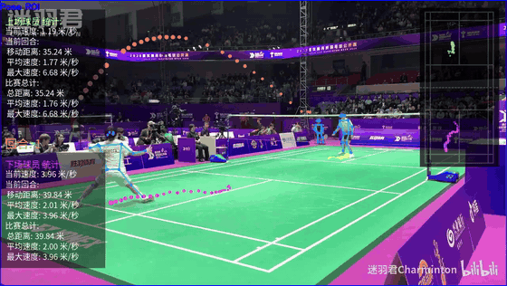
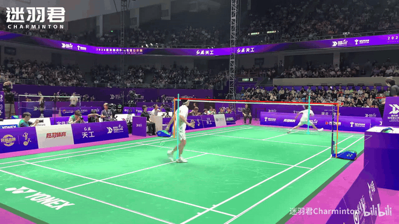
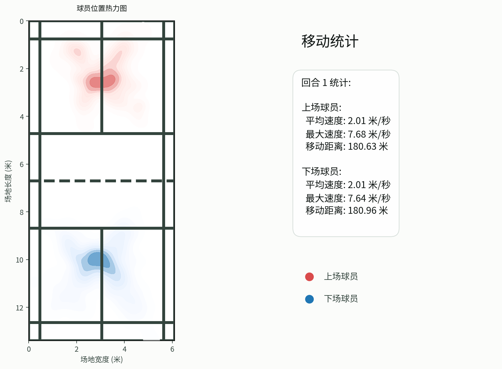
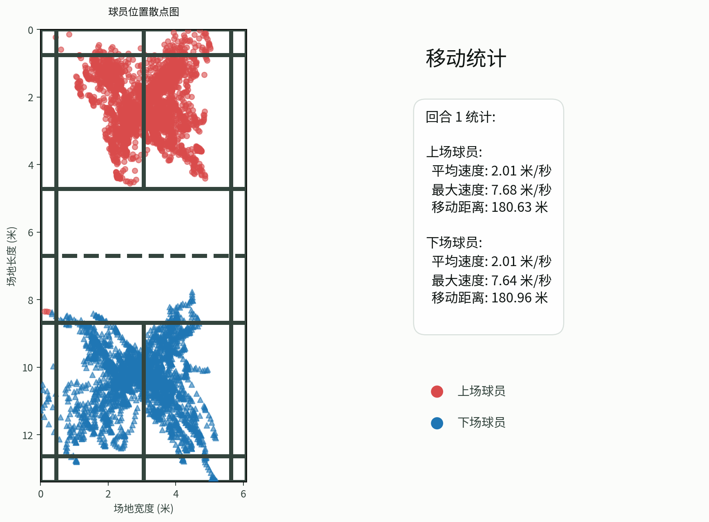
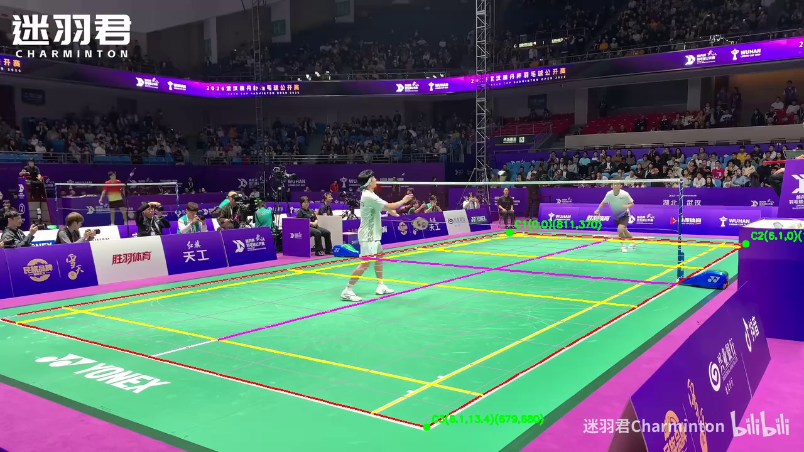

<div align="center">

# 🏸 AI-YuJian-AI · Feather-Eye (Low-Angle Auto-Calibration Edition)

### Turn match footage into replayable court data — even with the camera sitting on the floor at courtside

[](https://www.python.org/)
[](web/frontend/)
[](web/api/)
[](LICENSE)

**A local-first badminton video analysis tool: detects player poses, tracks the shuttlecock, maps court coordinates, and produces visual replay analytics.**
This repository is forked from [lzylovec/AI-YuJian-AI](https://github.com/lzylovec/lzylovec-AI-YuJian-AI) and adds **fully automatic low-angle court calibration** (no elevated camera, no manual corner picking).

[中文](README.md) · English · [Quick Start](#-quick-start) · [Auto Calibration](#-low-angle-automatic-court-calibration) · [Shooting Requirements](#shooting-requirements-and-usage-tips) · [Web Demo](#%EF%B8%8F-web-demo) · [Preview](#-preview)

</div>

---

## ✨ Overview

**AI-YuJian-AI** (羽见, "Feather-Eye") targets badminton training, match review, and computer-vision research. Given a match video and a one-time court calibration, the system converts on-screen detections into video overlays, court trajectories, movement statistics, and structured data.

It runs directly as a Python CLI, and also ships a local Web Demo where upload, clipping, calibration, queued analysis, and result download all happen in the browser.

> **YuJian (羽见)**: see every shuttle — and every movement.

## 🎬 Preview

<div align="center">



*Full demo video: [assets/lowangle_demo.mp4](assets/lowangle_demo.mp4) — real footage from behind the court at low angle (Lin Dan Cup match clip); shuttle trajectories, skeletons, and the stats panel stay stable throughout*

</div>

### 🎯 3D Trajectory Reconstruction (Camera Self-Calibration + Physics Fitting)

<div align="center">



*HD version: [assets/3d_demo_smash.mp4](assets/3d_demo_smash.mp4) — monocular low-angle 3D trajectory reconstruction. Yellow dashes = physics-fitted trajectory (gravity + air drag), gray dashes = low-confidence trajectory, green circle = back-extrapolated contact point with shot speed (a ≈238 km/h smash in this clip), magenta ✕ = predicted landing spot, cyan circle = net-crossing point, cyan pole = player's foot position (1.75 m)*

</div>

The camera intrinsics/extrinsics are solved automatically from the court lines alone (no calibration objects, no manual clicks), then shuttle detections are lifted to metric trajectories — contact height, shot speed, net clearance, and landing spot all become measurable. See the v3 section of [docs/IMPROVEMENTS_EN.md](docs/IMPROVEMENTS_EN.md) for details. To reproduce:

```bash
python camera_selfcalib.py --results-dir results/<name>   # camera self-calibration (inv(H) decomposition)
python hit_points3d.py    --results-dir results/<name>     # contact-point heights
python trajectory3d.py    --results-dir results/<name>     # physics trajectory fit + shot speed
python visualize3d.py     --results-dir results/<name>     # overlay trajectories back onto video
```

| Player position heatmap | Player position scatter plot |
| :---: | :---: |
|  |  |

| Low-angle automatic calibration result (green lines = court-line projection, blue line = net baseline) |
| :---: |
|  |

Traditional approaches demand a "god's-eye view" from high above the court, but most gyms have no second-floor camera position. This fork builds dedicated automatic calibration for **low angles behind the court** (about 1–2 person heights): one video frame is enough, no manual corner clicking.

## 🚀 Quick Start

### 1. Requirements

- Python 3.8+
- FFmpeg available in the system `PATH`
- NVIDIA GPU recommended; CPU works but analysis is considerably slower
- The default dependency install uses CPU builds of PyTorch and ONNX Runtime

### 2. Install analysis dependencies

```bash
git clone <your-repo-url>
cd AI-YuJian-AI

python -m venv .venv

# Windows PowerShell
.\.venv\Scripts\activate

# Linux / macOS
source .venv/bin/activate

python -m pip install --upgrade pip
pip install -r requirements.txt
```

### 3. Prepare model weights

Shuttlecock detection weights are not committed to the repository. Download them from the [upstream Releases](https://github.com/lzylovec/lzylovec-AI-YuJian-AI/releases) and place them at:

```text
weights/yolo11s-ball.pt
```

With `rtmpose` or `rtmo`, `rtmlib` fetches the corresponding ONNX models on demand (downloaded automatically on first run).

### 4. Run the CLI

```bash
# Low-angle video: fully automatic calibration (run calibration first and check
# the overlay image, then run the full pipeline once alignment looks right)
python fit_court_driver.py --video videos/your-video.mp4

# Full analysis (first run calibrates automatically and caches; later runs reuse it)
python main.py --video-path videos/your-video.mp4 \
               --template-path templates/first-frame.jpg \
               --display false

# Choose a pose model
python main.py --video-path videos/demo.mp4 --pose-family rtmpose --pose-mode balanced
python main.py --video-path videos/demo.mp4 --pose-family rtmo --pose-mode lightweight

# English visualization text
python main.py --video-path videos/demo.mp4 --language en

# AI coach analysis (requires the analysis above; configure the LLM gateway in
# config/llm_api.json, see the template config/llm_api.example.json)
python style_coach.py --name your-video-name
python style_coach.py --name your-video-name --skip-frames   # skip keyframe action review (faster)
python style_coach.py --name your-video-name --player-hint "lower=Momota Kento"  # known player identity

# Shot type recognition (smash/drop/clear/drive; runs standalone)
python shot_types.py results/your-video-name/detections.jsonl

# Pro style feature cards: build a player card from video / match against the card library
python pro_profiles.py --detections results/your-video-name/detections.jsonl --build "Momota Kento" --side lower
python pro_profiles.py --detections results/your-video-name/detections.jsonl --match --side lower
```

The AI coach extracts footwork/positioning/rhythm features from `detections.jsonl`, renders key frames with skeletons, and has an LLM generate `results/<video_name>/style_report.md`, including:

- **Playing-style portrait**: qualitative typing (attacking / counter-attacking defensive / control), backed by speed, positioning heat zones, and shot-type distribution
- **Positioning & footwork analysis**: home position, court coverage, and change-of-direction rhythm, with problems located
- **Shot type recognition**: rule-based classification of ball trajectories (smash / drop / clear / drive), with per-player shot distribution and "incoming → reply" response statistics
- **Pro style similarity**: weighted feature-vector nearest-neighbor matching (the card library is reproducible and extensible); the LLM only interprets computed results.
  The library ships measured cards plus star style profile cards (Lin Dan / Lee Chong Wei / Chen Long / Viktor Axelsen / Anthony Ginting / Anders Antonsen; `source: curated` entries are estimates from public style descriptions, limited precision, for style-tendency reference only)
- **Training advice**: actionable training items targeting the measured weaknesses
- **Key-frame technique review**: a vision model comments on balance, backswing, and footwork in skeleton frames

> When the player identities are known, pass `--player-hint "lower=Momota Kento"`; the report then verifies data against the real player instead of free-associating.
> Coverage and precision limits of shot type recognition are documented in `docs/IMPROVEMENTS_EN.md` (the calibration principle & failure criteria, shot-type confidence, and the 2D boundary sections are also merged there).

> `--template-path` accepts any clear frame from the video (with a fixed camera the whole clip shares one calibration).

On the first run:

1. If `results/<video_name>/court_annotations.txt` does not exist, court calibration runs first.
2. The calibration result is cached and reused automatically afterwards.
3. If the camera view, position, or template changes, delete the corresponding `court_annotations.txt` and recalibrate.

## 🎯 Low-Angle Automatic Court Calibration

The core improvement of this fork. Manual calibration is hard at low angles (perspective compression, occlusion make corners hard to click); this pipeline is fully automatic:

```text
Multiple video frames
   │
   ├── Green court-mat color prior → bound the court region
   ├── Temporal median of 45 white-line masks → remove player/shuttle occlusion
   ├── Hough line detection + dedup → court line segments
   │
   ▼
Homography hypothesis enumeration (~50k+)
   │
   ▼
Court-coordinate consistency scoring:
   map every detected line into the 6.1 m × 13.4 m standard half-court frame;
   a true solution's lines must collapse onto constant x/y values that
   match known model line positions
   │
   ▼
Bidirectional Chamfer pixel-distance refinement + orientation normalization
   │
   ▼
Four corners (model order) + net-height reference → court_annotations.txt
```

**Why does this work at low angles?**

- At low angles the far half-court compresses into a few dozen pixels and the near half-court is occluded by the net, so the classic "find four corners" approach mostly fails;
- This method scores hypotheses **in court coordinates**: no matter how short or slanted a line looks in the image, after mapping into true court coordinates it must be a vertical or horizontal straight line at a position matching a standard court line — a constraint that holds for any viewpoint;
- Net occlusion is actually a clue: near-half-court sidelines are truncated at the net posts, which helps locate the net.

### Shooting Requirements and Usage Tips

| Condition | Requirement |
| :--- | :--- |
| Camera | **Fixed** (the most critical); a tripod at courtside or any fixed position works — no elevated stand needed |
| View | Most court lines visible; the near baseline may be slightly out of frame, but **both far baselines must be clear** |
| Lighting | Even; avoid strong backlight / floor glare / large shadows covering the white lines |
| Quality | ≥720p; white lines at least a few pixels wide (too far/small degrades) |
| Court | Standard badminton court (white boundary lines + distinguishable mat color) |
| Frame rate | Know the true frame rate (speed conversion depends on it, default 30fps) |
| Angle | Verified for low angles behind the court (≈1–2 person heights); extreme ground-level upward angles amplify far-half-court error |

**Usage notes:**

- Calibration runs once (single frame); **if the camera moves, the mapping is wrong** — split multi-camera / moving-camera videos into segments
- Run automatic calibration first and check the saved overlay image before the full pipeline
- Precision is lower behind the net and near the far baseline (perspective compression + occlusion) — keep that in mind for fine tactical analysis
- Coordinates and speeds are true metric (anchored to the 6.1 m × 13.4 m standard half-court): near-half-court error ≈ ±0.1–0.3 m, far half-court ≈ ±0.5 m

> For the calibration algorithm (hypothesis enumeration + bidirectional Chamfer scoring), its tolerance of incomplete lines, failure criteria, and the mirror ambiguity, see "Court Calibration Principle and Failure Criteria" in `docs/IMPROVEMENTS_EN.md`.

## 🖥️ Web Demo

The Web Demo is a locally running visual workbench: videos are written to local `storage/`, results to local `results/`; no cloud service involved.

### Start the backend

```bash
pip install -r requirements.txt -r web-requirements.txt
python -m web.api.run
```

Backend: <http://127.0.0.1:8000>

### Start the frontend

In another terminal, with the same virtual environment:

```bash
cd web/frontend
npm install
npm run dev
```

Frontend: <http://127.0.0.1:5173>

The Web Demo supports:

- Match video upload and preview
- Clipping an analysis segment by start/end time
- Four-corner court calibration by clicking in the browser
- Queued / running / completed / failed job states
- Preview of the annotated video, heatmaps, and scatter plots
- Artifact download, job history, and local job deletion

## 🧠 Features

### Vision analysis

- **Player pose detection**: RTMPose, RTMO, and Ultralytics YOLO Pose.
- **Shuttlecock detection**: a YOLO model localizes the shuttlecock and draws cross-frame trajectories.
- **Automatic court calibration (new)**: fully automatic homography estimation at low angles, with manual four-point calibration as fallback.
- **Court coordinate mapping**: perspective transform from image coordinates to standard badminton court coordinates (true metric).
- **Player tracking**: separates the upper- and lower-court players and records court positions and trajectories.
- **Rally detection**: identifies rally intervals from continuous court views and labels rally IDs.

### Results and analytics

- **Motion statistics**: distance, instant/average/max speed, and rally count.
- **Position plots**: player heatmaps and scatter plots.
- **AI coach analysis (new)**: an LLM turns footwork/positioning/rhythm features and key-frame skeletons into a style portrait, pro-style similarity comparison, and training advice.
- **Video overlays**: toggle pose ROI, skeletons, player trajectories, court trajectories, shuttle trajectories, and the stats panel.
- **Structured export**: `metadata.json`, `session_summary.json`, and per-frame `detections.jsonl`.
- **Bilingual visualization**: switch CLI overlay text with `--language zh/en`.

## 🏗️ Processing pipeline

```text
Match video
   │
   ├── Player pose detection (RTMPose / RTMO / YOLO Pose)
   ├── Shuttlecock detection (YOLO)
   └── Court calibration
          │
          ├── Low angle: fit_court_driver.py auto calibration (color prior + line-consistency scoring)
          └── Or manual four-point calibration
                 │
                 ▼
   Perspective transform: image coords → standard court coords (true metric)
                 │
                 ▼
   Player tracking, rally detection, speed & distance statistics
                 │
                 ├── Annotated MP4
                 ├── Heatmap / scatter plots
                 └── JSON / JSONL structured data
```

## ⚙️ Common options

| Flag | Description | Default |
| :--- | :--- | :--- |
| `--video-path` | Input video path (required) | — |
| `--output-dir` | Output directory | `results/<video_name>` |
| `--ball-model` | Shuttlecock detection model path | `weights/yolo11s-ball.pt` |
| `--pose-family` | `rtmpose` / `rtmo` / `yolo-pose` | `rtmpose` |
| `--pose-mode` | `lightweight` / `balanced` / `performance` | `balanced` |
| `--yolo-pose-model` | YOLO Pose model path or name | `yolo11n-pose.pt` |
| `--template-path` | Court template image path | file picker |
| `--display` | Show OpenCV preview window | `true` |
| `--skeletons` | Draw body skeletons | `true` |
| `--player-trajectories` | Draw player trajectories | `true` |
| `--court-trajectory` | Draw court trajectories | `true` |
| `--shuttlecock-trajectory` | Draw shuttle trajectories | `true` |
| `--player-stats` | Show player stats panel | `true` |
| `--visualize-positions` | Generate heatmap and scatter plots | `true` |
| `--audio` | Keep original audio | `true` |
| `--language` | Visualization language: `zh` / `en` | `zh` |
| `--save-images` | Save per-frame images | `false` |
| `--performance-stats` | Print performance statistics | `false` |

## 📦 Output

The CLI writes to `results/<video_name>/` by default:

```text
results/<video_name>/
├── metadata.json                  # video, model, calibration, and output metadata
├── detections.jsonl               # per-frame detection records (metric court coords & speeds)
├── detect_<video_name>.mp4        # video with skeletons, trajectories, and stats panel
├── court_annotations.txt          # calibration cache (automatic or manual)
├── style_report.md                # AI coach analysis report (requires LLM config)
├── coach_frames/                  # key-frame skeleton images (AI coach)
├── shot_analysis/                 # shot type recognition (arc details / stats / overview plot)
└── position_visualizations/
    ├── heatmaps/                  # player position heatmaps
    └── scatter_plots/             # player position scatter plots
```

Web / service mode additionally writes `session_summary.json` into the corresponding job directory, recording job status, summary statistics, and artifact indexes.

## 🧩 Project structure

```text
AI-YuJian-AI/
├── main.py                       # CLI entry point
├── fit_court_driver.py           # low-angle auto calibration entry (fork addition)
├── court_fit.py                  # auto calibration core algorithm (fork addition)
├── style_coach.py                # AI coach analysis entry (fork addition)
├── style_features.py             # style/positioning/footwork feature extraction (fork addition)
├── keyframes.py                  # key-frame skeleton extraction (fork addition)
├── shot_types.py                 # shot type recognition (fork addition)
├── pro_profiles.py               # pro style feature-card matching (fork addition)
├── profiles/                     # feature card library (fork addition): measured cards + star profile cards (Lin Dan / Lee Chong Wei / Chen Long / Axelsen / Ginting / Antonsen)
├── docs/IMPROVEMENTS.md          # tech doc (Chinese): calibration principle / methodology / changelog / known limits (fork addition, single tech doc)
├── docs/IMPROVEMENTS_EN.md       # tech doc (English): mirror of the above
├── badminton_analysis/           # core video-analysis pipeline
│   ├── court/                    # court calibration and coordinate mapping
│   ├── data/                     # JSON / JSONL persistence
│   ├── detection/                # pose and shuttlecock detection
│   ├── media/                    # video and audio processing
│   ├── tracking/                 # player tracking
│   └── visualization/            # video overlays and charts
├── web/
│   ├── api/                      # FastAPI job service
│   └── frontend/                 # React + Vite frontend
├── assets/                       # demo GIF, videos, and sample images
├── config/                       # local private config (gitignored; includes example file)
├── templates/                    # court template images
├── videos/                       # sample input videos
├── specs/                        # design and requirements docs
├── requirements.txt              # analysis dependencies
└── web-requirements.txt          # web backend dependencies
```

## 🔮 Roadmap

- [x] Frame-by-frame badminton match video analysis
- [x] RTMPose / RTMO / YOLO Pose multi-model pose support
- [x] YOLO shuttlecock detection model integration
- [x] Manual court calibration and coordinate mapping
- [x] **Low-angle automatic court calibration (fork addition)**
- [x] Player trajectories, speed, distance, and rally statistics
- [x] Heatmaps, scatter plots, and structured data export
- [x] Local Web Demo: upload, calibration, queued analysis, and downloads
- [x] **AI coach analysis: style portrait, footwork diagnosis, pro-style similarity, training advice (fork addition)**
- [x] **Shot type recognition and pro feature-card matching (fork addition)**
- [ ] Dynamic calibration for action cameras / moving shots
- [ ] More stable hit-point recognition
- [ ] More accurate shuttlecock detection (e.g., TrackNetV3)
- [ ] More complete stroke statistics
- [ ] Batch video analysis workflow

## 🛠️ Tech stack

<p>
  
  
  
  
  
  
  
  
</p>

## 🙏 Acknowledgements

- [lzylovec/AI-YuJian-AI](https://github.com/lzylovec/lzylovec-AI-YuJian-AI): the upstream of this fork, providing the full analysis pipeline and Web Demo
- [TrackNetV2](https://github.com/wywyWang/TrackNetV2): badminton dataset-related work
- [RTMPose](https://github.com/open-mmlab/mmpose): human pose estimation
- [Ultralytics YOLO](https://github.com/ultralytics/ultralytics): object-detection ecosystem

## 📄 License

Project code follows the upstream [Apache License 2.0](LICENSE). Model weights are not committed to the repository; follow each upstream project's license and attribution requirements when downloading and redistributing.

> Match footage in the demo assets comes from public web videos, copyrighted by their original owners, used solely for algorithm demonstration.

---

<div align="center">

If this project helps you, a ⭐ would be appreciated.

**Forked from [lzylovec/AI-YuJian-AI](https://github.com/lzylovec/lzylovec-AI-YuJian-AI) · Low-angle auto-calibration edition**

</div>
